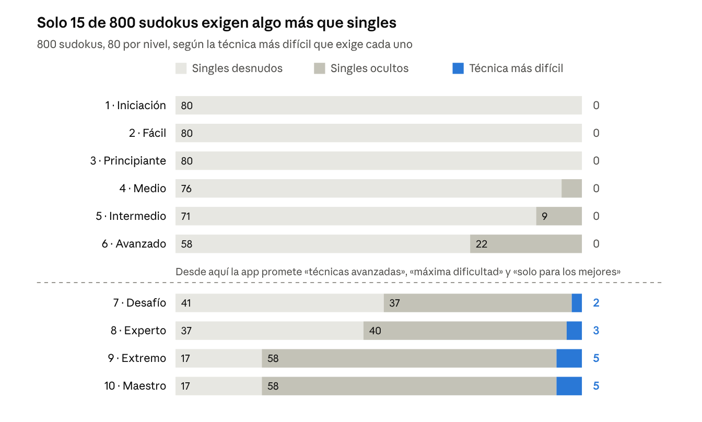
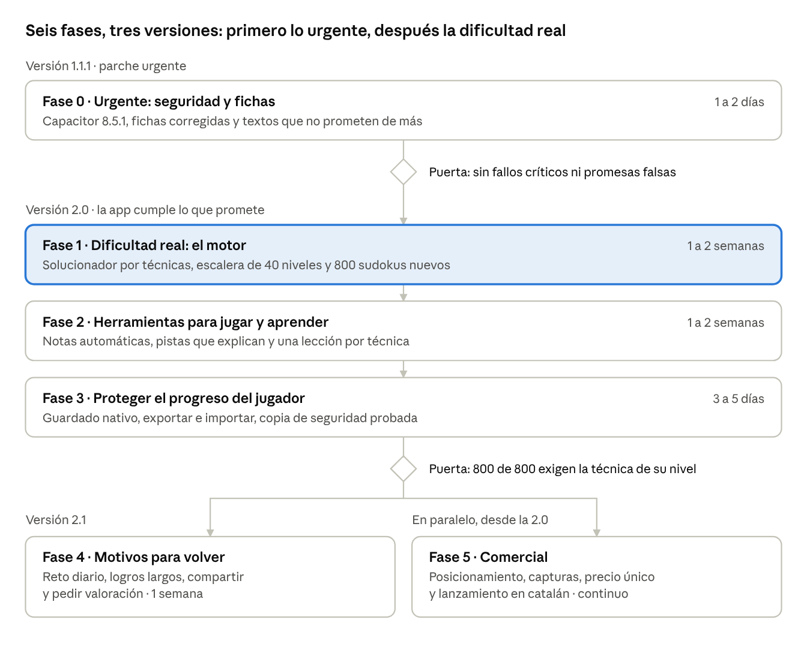

# Informe y plan de SUDOKU KING

12 de noviembre de 2026 · Francesc Siuraneta Jové

> Copia del informe tal como quedó el 12 de noviembre de 2026 (revisión 15). También en [PDF](2026-11-12-informe-y-plan.pdf). El original editable es un [documento privado](https://claude.ai/artifact/C3WCFvGjKjSWSg59SPt1Hc). La medición se repite con `node informes/2026-11-12-medicion.mjs`.

SUDOKU KING no cumple su promesa de dificultad progresiva: el 98,1 % de sus 800 sudokus se resuelve con las dos técnicas más básicas, también en el nivel «Maestro». Este informe lo demuestra, reúne el resto de fallos encontrados y los resuelve todos en seis fases.

## El problema principal: la dificultad no progresa

La app promete diez niveles de dificultad creciente y entrega prácticamente uno. He resuelto los 800 sudokus midiendo la técnica mínima que exige cada uno: 785 caen solo con *singles*, las dos técnicas que aprende cualquier principiante.

Un *single desnudo* es una casilla donde solo cabe un número. Un *single oculto* es un número que, en una fila, columna o caja, solo cabe en una casilla. No hay técnica más sencilla que estas dos.

| Nivel | Lo que dice la app | Pistas | Lo que exige de verdad |
| --- | --- | --- | --- |
| 1 · Iniciación | Perfecto para empezar | 50 | Singles desnudos |
| 2 · Fácil | Muy accesible | 46 | Singles desnudos |
| 3 · Principiante | Desafío suave | 42 | Singles desnudos |
| 4 · Medio | Agilidad mental | 39 | Singles desnudos, casi siempre |
| 5 · Intermedio | Nivel equilibrado | 37 | Singles desnudos, casi siempre |
| 6 · Avanzado | Requiere concentración | 35 | Singles desnudos u ocultos |
| 7 · Desafío | **Técnicas avanzadas** | 33 | Singles desnudos u ocultos |
| 8 · Experto | **Para jugadores versados** | 32 | Singles desnudos u ocultos |
| 9 · Extremo | **Máxima dificultad** | 31 | Singles ocultos, casi siempre |
| 10 · Maestro | **Solo para los mejores** | 30 | Singles ocultos, casi siempre |

La promesa falla en cuatro sitios a la vez:

- **Entre niveles.** Del 1 al 10 solo baja el número de pistas. La técnica necesaria apenas cambia.
- **En la cima.** «Extremo» y «Maestro» son indistinguibles: la medición da el mismo reparto en los dos.
- **Dentro de cada nivel.** La app dice «20 sudokus con dificultad progresiva». Los 20 tienen las mismas pistas y no siguen ningún orden de dificultad.
- **Entre packs.** Los cuatro packs repiten las mismas diez bandas. Pagar un pack da más sudokus iguales, no más difíciles.

Un jugador con experiencia termina el nivel «Maestro» sin haber necesitado nada que no usara en el nivel 3. Ese es el fallo que este plan pone primero.

## La medición, nivel a nivel

*Medición propia sobre `src/data/puzzles.ts` · 800 sudokus · 12 de noviembre de 2026*

Los datos del gráfico, sobre los 80 sudokus de cada nivel (20 por pack, cuatro packs):

| Nivel | Singles desnudos | Singles ocultos | Técnica más difícil |
| --- | --- | --- | --- |
| 1 | 80 | 0 | 0 |
| 2 | 80 | 0 | 0 |
| 3 | 80 | 0 | 0 |
| 4 | 76 | 4 | 0 |
| 5 | 71 | 9 | 0 |
| 6 | 58 | 22 | 0 |
| 7 | 41 | 37 | 2 |
| 8 | 37 | 40 | 3 |
| 9 | 17 | 58 | 5 |
| 10 | 17 | 58 | 5 |
| **Total** | **557** | **228** | **15** |

La franja azul es lo único que exige una técnica por encima de singles. No existe hasta el nivel 7 y nunca pasa de 5 sudokus de 80.

## Por qué ocurre

El generador mide la dificultad por número de pistas, y el número de pistas no decide qué técnica hace falta. Las causas están todas en `scripts/generatePuzzles.mjs` y en su verificación:

- **La banda es solo un número de pistas.** Cada nivel tiene un objetivo, de 50 a 30, y nada más.
- **Nunca se exige una técnica difícil.** En las bandas 1 a 3 el generador obliga a que el sudoku salga con singles. En las bandas 4 a 10 solo comprueba que la solución sea única.
- **Quitar pistas al azar no crea dificultad.** Con 30 pistas o más, casi todo lo que sale se resuelve con singles. Las técnicas avanzadas hay que buscarlas a propósito.
- **Los packs repiten la escalera.** La banda se calcula como el resto de dividir el nivel entre 10, así que los packs II, III y IV vuelven a empezar en 50 pistas.
- **La prueba automática no mira la dificultad.** `puzzles:verify` comprueba solución única y reparto de pistas. Por eso el fallo pasó todas las pruebas y llegó a producción.

Todo está en el mismo sitio, así que la corrección es una sola pieza de trabajo: la Fase 1.

## Todo lo demás que hay que arreglar

Además de la dificultad hay quince problemas más. Cada uno tiene una fase que lo resuelve.

| Área | Problema | Dónde se ve | Fase |
| --- | --- | --- | --- |
| Seguridad | La versión publicada lleva Capacitor 8.5.0, afectado por la vulnerabilidad CVE-2026-103922 (gravedad 9,3 sobre 10). Se corrige en 8.5.1 | `npm audit` | 0 |
| Seguridad | No hay Content-Security-Policy | `index.html` | 0 |
| Ficha | En la App Store española la descripción sale en catalán | Ficha en vivo | 0 |
| Ficha | La App Store indica «Inglés» como único idioma de la app | `Info.plist` no declara catalán ni castellano | 0 |
| Ficha | Las dos fichas dicen «6 temas» y hay 12 | Fichas en vivo | 0 |
| Honestidad | Los textos de los niveles prometen técnicas avanzadas que el contenido no exige | Niveles 7 a 10 | 0 y 1 |
| Jugabilidad | Las pistas revelan un número sin explicar por qué | `giveHint` | 2 |
| Jugabilidad | No hay notas automáticas | No existe en el código | 2 |
| Datos | El progreso vive solo en el almacenamiento del WebView, sin copia propia ni exportación | `persistence.ts` | 3 |
| Retención | No hay reto diario y la racha no avisa | No existe en el código | 4 |
| Retención | Los ocho logros se agotan en la primera semana | `achievements.ts` | 4 |
| Retención | No se pide valoración ni se puede compartir un resultado | `VictoryModal` | 4 |
| Comercial | Google Play marca «1+ descargas» y ninguna tienda muestra valoraciones | Fichas en vivo | 5 |
| Comercial | Techo de 2,97 € por usuario, con packs de pago iguales al gratuito | `packs.ts` | 1 y 5 |
| Comercial | Las capturas son del tema oscuro, y las nuevas de iPhone no caben en la ficha | Fichas en vivo | 5 |

Sobre la vulnerabilidad: el riesgo práctico en esta app es bajo. Explotarla exige que alguien pulse un enlace dentro de la app, y la app no muestra contenido de otros usuarios. Aun así, una versión publicada no debe llevar un fallo crítico conocido, y por eso va en la Fase 0.

## El plan de un vistazo

*Hoja de ruta · 6 fases, 2 puertas, 3 versiones*

La 1.1.1 sale sola y cuanto antes. Las fases 1, 2 y 3 se publican juntas, porque la dificultad real sin ayudas frustra y la migración de datos conviene hacerla una sola vez.

## Fase 0. Urgente: seguridad y fichas

Se publica una versión 1.1.1 que cierra la vulnerabilidad y deja de prometer lo que la app todavía no da. Esfuerzo estimado: uno o dos días.

- [ ] Subir Capacitor de 8.5.0 a 8.5.1 en Android e iOS y recompilar.
- [ ] Añadir una Content-Security-Policy a `index.html`.
- [ ] Cambiar los textos de los niveles 7 a 10 y la frase «dificultad progresiva» por descripciones que el contenido actual sí cumple. Es un parche honesto hasta que llegue la Fase 1.
- [ ] Declarar catalán, castellano e inglés en `Info.plist`, para que la App Store deje de decir «Inglés».
- [ ] Añadir castellano e inglés a la ficha de la App Store. Los textos ya están escritos en `store/LISTING.md`.
- [ ] Corregir «6 temas» por 12 en las dos fichas.
- [ ] Crear los cuatro secretos `ANDROID_*` en GitHub y fijar `JAVA_HOME` en el Mac, que siguen pendientes.

**Puerta de salida:** `npm audit` sin vulnerabilidades críticas, la App Store española muestra la ficha en castellano con los tres idiomas, y ningún texto de la app promete una técnica que los sudokus no exigen.

## Fase 1. Dificultad real: el motor

La dificultad deja de medirse en pistas y pasa a medirse en la técnica que hace falta, y la promesa se comprueba sola en cada cambio. Es el núcleo del plan. Esfuerzo estimado: una o dos semanas.

Hacerlo ahora cuesta poco, porque casi no hay jugadores con progreso que migrar.

- [ ] Escribir un solucionador que resuelve como una persona: aplica las técnicas de la más fácil a la más difícil y anota cuál necesitó y cuántas veces.
- [ ] Convertir los 40 niveles en una sola subida continua, según la tabla de abajo, en lugar de cuatro packs que repiten diez bandas.
- [ ] Rehacer el generador: quita pistas hasta que el solucionador confirma que el sudoku exige la técnica de su nivel, ni menos ni más. Descarta los que obliguen a adivinar.
- [ ] Ordenar los 20 sudokus de cada nivel de menos a más pasos difíciles, para que la progresión exista también dentro del nivel.
- [ ] Ampliar `puzzles:verify`: la integración continua falla si un solo sudoku no exige la técnica de su nivel.
- [ ] Guardar en el repositorio el script de medición de este informe, para repetir la prueba cuando se quiera.
- [ ] Regenerar los 800 sudokus y migrar el progreso guardado. Se conservan estrellas, experiencia, racha y compras; se reinicia el detalle por sudoku de los niveles que cambian.
- [ ] Renombrar niveles y packs según lo que exigen y devolver a la app los textos de dificultad, ahora ciertos.

Escalera propuesta. Con ella, pagar un pack desbloquea dificultad nueva de verdad:

| Tramo | Niveles | Técnica más difícil que exige |
| --- | --- | --- |
| Pack I, gratis | 1 a 3 | Singles desnudos |
| Pack I, gratis | 4 a 6 | Singles ocultos |
| Pack I, gratis | 7 a 10 | Candidatos bloqueados: un número que, dentro de una caja, solo cabe en una fila o columna |
| Pack II | 11 a 20 | Pares y tríos, primero desnudos y luego ocultos |
| Pack III | 21 a 30 | X-Wing y cuartetos |
| Pack IV | 31 a 40 | XY-Wing, Swordfish y cadenas cortas |

**Puerta de salida:** la medición de este informe, repetida sobre el catálogo nuevo, da 800 de 800: cada sudoku exige exactamente la técnica que su nivel declara. La integración continua lo comprueba en cada cambio.

**Riesgo:** generar sudokus de las técnicas más altas es lento y algún tramo puede salir con poca variedad. Si ocurre, se acorta ese tramo antes que rebajar la exigencia.

## Fase 2. Herramientas para jugar y aprender

El jugador recibe las ayudas que necesita para resolver lo que la Fase 1 le pone delante, y aprende cada técnica dentro de la app. Un sudoku difícil sin ayudas frustra, así que esta fase se publica junto con la Fase 1. Esfuerzo estimado: una o dos semanas.

- [ ] Notas automáticas: un botón rellena los candidatos de todas las casillas y los mantiene al día.
- [ ] Pistas que explican en tres pasos: señalan la zona, nombran la técnica y solo al final revelan el número. Usan el mismo solucionador de la Fase 1.
- [ ] Una lección corta por técnica al llegar al primer nivel que la exige, con un ejemplo que se resuelve tocando.
- [ ] Modo «número primero»: elegir un número y marcar sus casillas, además del modo actual.
- [ ] Resaltar en el tablero los candidatos del número seleccionado.
- [ ] Pruebas automáticas de todo lo anterior.

**Puerta de salida:** un jugador que no conoce una técnica la aprende y la aplica sin salir de la app. Ninguna pista revela un número sin haber ofrecido antes la explicación.

## Fase 3. Proteger el progreso del jugador

El progreso pasa a un almacenamiento nativo y recuperable. Va en la misma versión 2.0 que las fases 1 y 2, para migrar los datos de cada jugador una sola vez. Esfuerzo estimado: de tres a cinco días.

- [ ] Mover el guardado del almacenamiento del WebView al almacenamiento nativo del sistema, con migración automática al actualizar.
- [ ] Añadir en Ajustes exportar e importar el progreso como archivo.
- [ ] Probar en un iPhone y un Android reales que la copia de seguridad del sistema restaura el progreso.
- [ ] Pruebas automáticas de la migración, incluida la de un guardado corrupto.

**Puerta de salida:** desinstalar la app y restaurar la copia en un dispositivo real devuelve niveles, estrellas y racha.

## Fase 4. Motivos para volver

La app ofrece algo nuevo cada día y objetivos a más de un mes. Se publica como versión 2.1, cuando la 2.0 ya cumple lo que promete. Esfuerzo estimado: una semana.

- [ ] Reto diario: un sudoku por fecha, el mismo para todos, calculado en el dispositivo y sin servidor. Con calendario del mes.
- [ ] Recordatorio opcional de la racha con notificación local. Lo activa el jugador y no sale ningún dato del teléfono.
- [ ] Logros de largo recorrido: uno por técnica dominada, rachas de 7, 30 y 100 días, y packs completos.
- [ ] Botón para compartir el resultado al terminar un sudoku.
- [ ] Pedir valoración con el diálogo nativo de cada tienda, tras una victoria de tres estrellas y nunca antes de la quinta partida.

La valoración se pide aquí y no antes a propósito. Pedir reseñas mientras la dificultad no cumple lo prometido invita a reseñas malas.

**Puerta de salida:** cada día hay un sudoku nuevo, y un jugador constante sigue teniendo objetivos pendientes pasados 30 días.

## Fase 5. Comercial: que la encuentren y tenga sentido pagar

La app se presenta como lo que por fin es, el sudoku sin anuncios que enseña a mejorar, y se mide con los datos de las propias tiendas. Arranca cuando la 2.0 está publicada y continúa después.

- [ ] Posicionamiento: «sin anuncios» y «aprende técnicas» en el subtítulo, las palabras clave y la primera captura de las dos fichas.
- [ ] Capturas nuevas con el tema claro y las funciones de la 2.0: iPhone a 1206×2622 y Android a 1080×2160.
- [ ] Una compra única «Desbloquear todo» junto a los packs sueltos. Quien ya compró conserva lo suyo.
- [ ] Lanzamiento en catalán: nota a medios locales y en lengua catalana, un público que casi nadie atiende.
- [ ] Conseguir las primeras veinte valoraciones pidiéndolas a conocidos, antes de cualquier otra acción.
- [ ] Declarar en la App Store las prestaciones de accesibilidad que la app ya tiene.
- [ ] Revisar cada mes en Play Console y App Store Connect las instalaciones, la retención y las compras. Esos datos solo los ves tú, y la app sigue sin llevar ningún rastreador.

Lo que no se hace: anuncios, suscripción ni servidor propio. Los tres destruyen lo único que hoy diferencia a la app.

**Puerta de salida:** las dos fichas prometen exactamente lo que la app cumple, y hay un mes de datos para decidir si se invierte más.

Una expectativa honesta: el sudoku es una categoría muy saturada. Incluso con todo el plan hecho, lo razonable es esperar un ingreso pequeño.

## Decisiones que te tocan

Cinco decisiones son tuyas. En cada una va mi recomendación.

| Decisión | Recomiendo | Por qué |
| --- | --- | --- |
| ¿Se publica la 1.1.1 de la Fase 0 sin esperar a la 2.0? | Sí | Cierra la vulnerabilidad y corrige las fichas en días |
| ¿Se regeneran los 800 sudokus y se reinicia el detalle del progreso? | Sí, ahora | Casi no hay jugadores; más adelante costará más |
| ¿Escalera continua de 40 niveles, o packs que repiten las mismas bandas? | Continua | Es lo que hace que pagar desbloquee dificultad nueva |
| ¿Precio de «Desbloquear todo»? | Entre 3,99 y 4,99 € | Hoy el máximo por usuario es 2,97 € |
| ¿Recordatorio de racha con notificación? | Sí, opcional y apagado de inicio | Sostiene el hábito sin romper la promesa de privacidad |

## Fuentes

- Medición de dificultad: los 800 sudokus de `src/data/puzzles.ts`, resueltos con un script propio el 12 de noviembre de 2026.
- [Ficha en Google Play](https://play.google.com/store/apps/details?id=com.ivoriaplicacions.maestrosdelsudoku&hl=es&gl=ES), consultada el 12 de noviembre de 2026.
- [Ficha en la App Store](https://apps.apple.com/es/app/sudoku-king/id6820476970), consultada el mismo día.
- [Aviso de seguridad GHSA-rvm3-566m-v7fv](https://github.com/advisories/GHSA-rvm3-566m-v7fv), que describe la vulnerabilidad CVE-2026-103922 de Capacitor.
